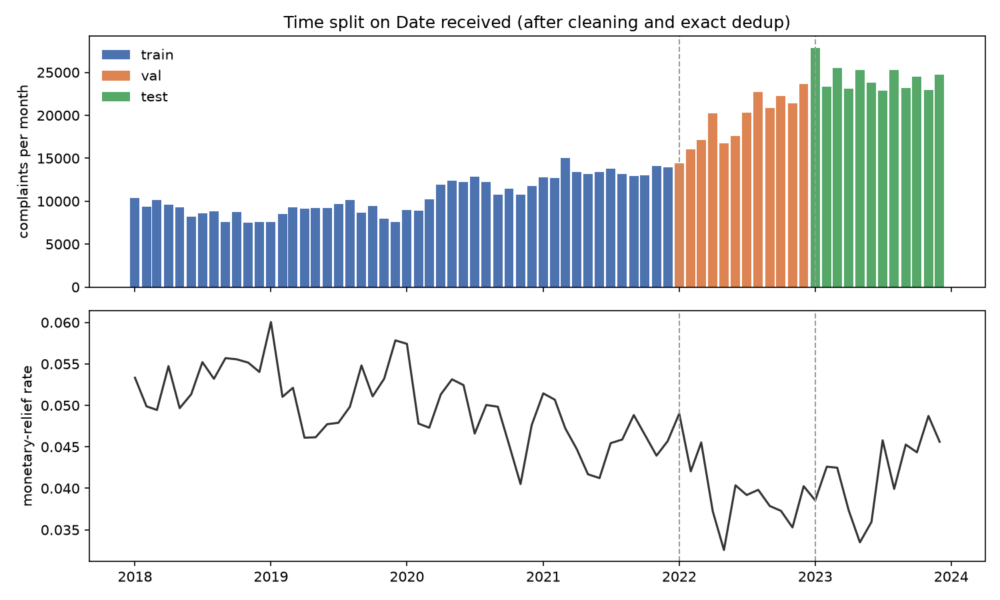
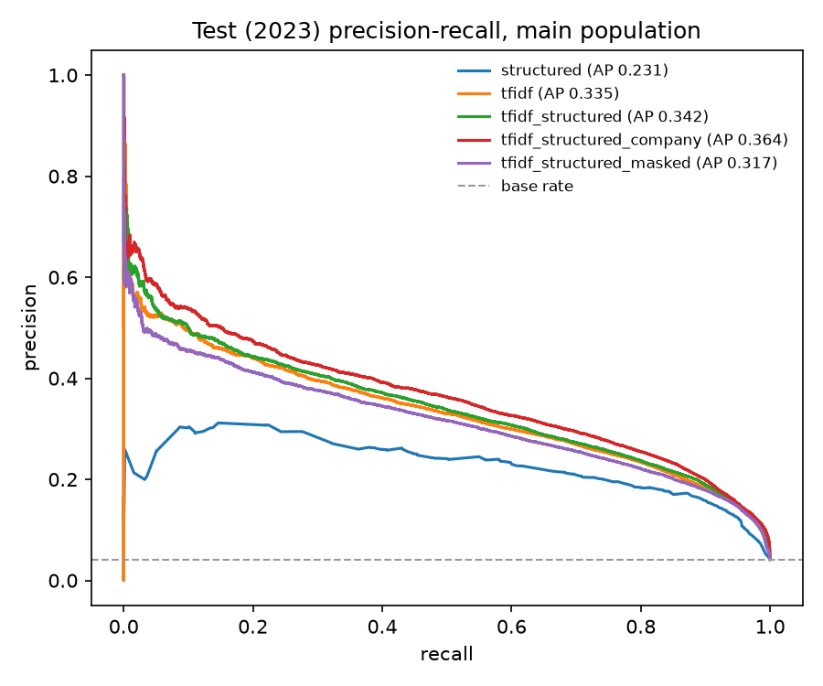
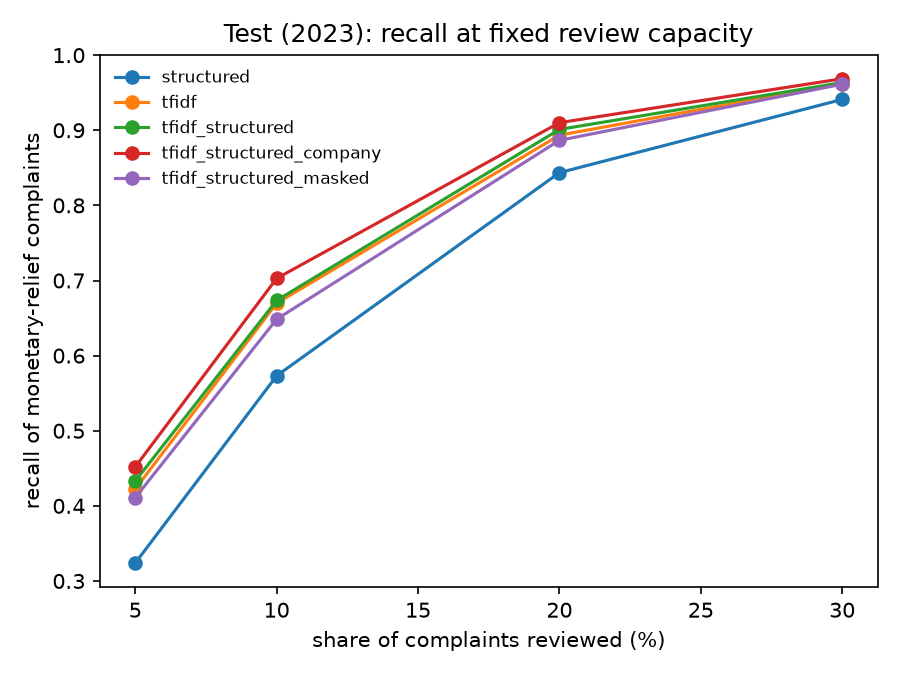
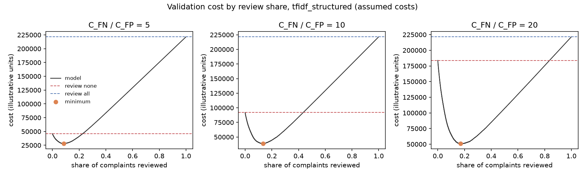
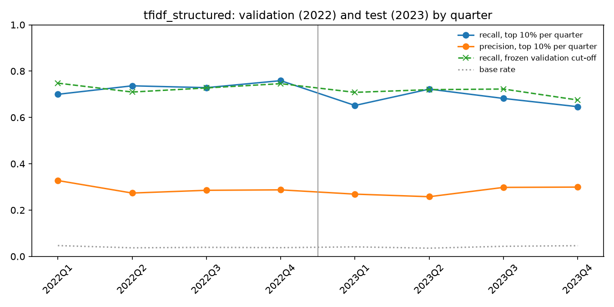

# Financial Complaint Triage: NLP-Based Monetary-Relief Prediction and Cost-Sensitive Review Allocation

**On the held-out 2023 test year, reviewing the 10% of complaints the main model ranks highest captured 67.4% of the complaints that were later closed with monetary relief.** Precision in that top 10% was 28.1%, which is 6.7 times the 4.17% base rate.

The model is TF-IDF on the complaint narrative plus product and issue fields, with logistic regression. It was trained on CFPB complaints from 2018 to 2021, tuned and thresholded on 2022, and scored once on 2023. Every number in this README comes from a local run of the scripts in this repository. Costs are assumed, illustrative units, not dollars.

| | Validation 2022 | Test 2023 |
|---|---|---|
| Complaints (main setting) | 230,679 | 291,056 |
| Monetary-relief rate | 3.98% | 4.17% |
| PR-AUC, main model | 0.3843 | 0.3424 |
| Recall when reviewing the top 10% | 73.4% | 67.4% |
| Cost saving vs. the better no-model baseline, C_FN / C_FP = 10, threshold frozen on validation | 57.8% | 54.2% |

## What the label means, and what it does not

The positive class is `Company response to consumer == "Closed with monetary relief"`. The negative class is any other closed response: `Closed with non-monetary relief`, `Closed with explanation`, or `Closed`. Complaints whose outcome is unknown, `In progress` and `Untimely response`, are removed, not treated as negatives.

This is a **proxy label**. It records whether a complaint eventually ended with money returned to the consumer. It is not a measure of how serious a complaint is, and it is not a list of complaints that must be escalated. A complaint that got no money can still be serious, and whether money was paid also depends on process, evidence and company policy. The only claim this project makes is that the model ranks complaints by how likely they are to end in monetary relief.

## Data

### Sources

The narrative text and the labels come from two different CFPB exports. Full provenance, hashes and dates are in [docs/data_sources.md](docs/data_sources.md).

- **Narratives** come from the official CFPB export as archived by the Internet Archive on 2025-12-09. The original file was last modified on 2025-12-07, and its SHA-256 is `27350c1d6f297db7776851ebfa23caaedbc54dcc356e224d66e2cf5d41d2fba5`. As of 2026-10-23, the current official export has no narrative column, and the CFPB search API rejects the narrative field. Narratives can no longer be downloaded from official CFPB channels, so this dataset cannot be rebuilt from CFPB directly.
- **Labels and intake fields** come from the current official export, downloaded on 2026-10-23. It contains 18,621,136 complaints received between 2011-12-01 and 2026-10-23.

Archive rows were joined to the official export on `Complaint ID`. Of the 1,445,816 archived complaints with a narrative received in 2018–2023, 1,445,608 matched, a 99.99% match rate. The other 208 did not match, and none of the matched rows disagree on `Date received`.

Training starts on 2018-01-01. Before 2018 the response categories were different: `Closed with relief` and `Closed without relief` appear only in 2011–2012, and `Closed` only through 2017. Those older categories are not mapped onto the new ones.

### Fields

| Field | Use |
|---|---|
| `Consumer complaint narrative` | Model input after cleaning |
| `Product`, `Sub-product`, `Issue`, `Sub-issue` | Model input, one-hot encoded |
| `Company` | Model input only in the company ablation |
| `Date received` | Time split only, never a feature |
| `Company response to consumer` | Label only, never a feature |
| `Company public response`, `Timely response?`, `Consumer disputed?`, `Date sent to company`, `Tags`, `Submitted via`, `State`, `ZIP code` | Never used |

### Cleaning

| Step | Rows left | Removed |
|---|---|---|
| Matched archive and official rows, 2018–2023 | 1,445,608 | |
| Outcome known | 1,442,783 | 2,825, or 0.20%: 2,823 `Untimely response`, 2 missing, 0 `In progress` |
| Narrative at least 50 characters after removing `XXXX` redactions | 1,429,846 | 12,937, or 0.90% |
| Exact duplicate narratives removed, keeping the earliest | 1,033,357 | 396,489 |

The share of complaints removed for an unknown outcome is 0.53% in 2018, 0.10% in 2022 and 0.08% in 2023. The export was taken almost three years after the end of the test year, so right-censoring of the 2023 labels is small.

Exact duplicates are mostly templated complaints, and almost all of them are negative. Removing them raised the positive rate in the test year from 2.53% to 4.16%. In 178 groups of identical narratives, the copies have different labels. A separate `raw_queue` evaluation below keeps the duplicates in, because a real review queue would contain them.

## Leakage controls

- **Prediction time:** the moment a complaint enters the review queue. Only fields known at intake are allowed.
- **Allow-list check:** `src/triage/leakage.py` holds an allow-list and a block-list. Training stops with an error if any feature is on the block-list or missing from the allow-list. The audit for every model is written to `reports/tables/05_leakage_audit.json`.
- **Train-only fitting:** the TF-IDF vocabulary, the one-hot encoders and the company-name mask list are all fitted on the training years only.
- **No test data before the test step:** the training and threshold scripts load only the training and validation rows. The data is read with a filter on `split`.
- **Test opened once:** opening the test set writes `reports/test_opened.lock`. After that, retraining or re-thresholding is refused. Any forced re-run is logged.
- **Near duplicates across splits:** two narratives count as near duplicates when their sets of 5-word shingles have Jaccard similarity of at least 0.8. Candidates are found with MinHash LSH and each one is confirmed with the exact Jaccard.
  - Near duplicates of a training complaint: 2,638 validation complaints (1.13%) and 1,149 test complaints (0.39%). The main setting drops these.
  - 17,544 test complaints (6.00%) are near duplicates of a validation complaint. They are kept and reported, because validation is used only for tuning and thresholds.

## Time split

| Split | Dates | Complaints, main setting | Monetary-relief rate |
|---|---|---|---|
| Train | 2018-01-01 to 2021-12-31 | 507,835 | 4.94% |
| Validation | 2022-01-01 to 2022-12-31 | 230,679 | 3.98% |
| Test | 2023-01-01 to 2023-12-31 | 291,056 | 4.17% |



Split dates are command-line arguments. Regularisation strength C and every threshold were chosen on validation only.

## Models

All five models are L2-regularised logistic regression. TF-IDF uses 1–2 grams, min_df 5 and at most 200,000 terms, with the vocabulary fitted on a random 200,000 training narratives. C was chosen from 0.25, 1 and 4 by validation PR-AUC.

| Model | Inputs | C | Val PR-AUC | Test PR-AUC | Test recall at 10% |
|---|---|---|---|---|---|
| `structured` | Product, issue fields | 0.25 | 0.2800 | 0.2311 | 57.3% |
| `tfidf` | Narrative | 1 | 0.3641 | 0.3348 | 67.0% |
| **`tfidf_structured`, main model** | Narrative, product, issue fields | 1 | **0.3843** | **0.3424** | **67.4%** |
| `tfidf_structured_company` | Main model plus `Company` | 0.25 | 0.4115 | 0.3641 | 70.3% |
| `tfidf_structured_masked` | Main model with company names in the text masked | 1 | 0.3521 | 0.3173 | 64.8% |

The models rank in the same order on validation and test. The narrative adds clear signal on top of the structured fields: 0.111 test PR-AUC for the main model over `structured`.



### Is the model memorizing companies?

The main model has no company field, but the narrative often names the company. The strongest positive terms in the text-only model include `coinbase`, `synchrony`, `chase`, `paypal`, `pennymac`, `bank of america` and `bofa`. The strongest negative terms include `equifax`, `experian`, `chime` and `cash app`. Company identity therefore reaches the model through the text anyway.

To measure this, a masked variant replaces company names in the text with a single placeholder before training. The mask list has 879 phrases built from training-period company names plus a short hand-written list of abbreviations, and it is saved to `reports/tables/05_company_mask_phrases.txt`.

- Masking lowers test PR-AUC from 0.3424 to 0.3173.
- Adding the explicit company field raises it to 0.3641.
- Even masked, text beats structured fields alone, 0.3173 against 0.2311.

So part of the text signal is company identity, but not most of it. The mask is incomplete, though. Names such as `binance`, `zelle`, `mr cooper`, `square`, `bluebird` and `fortiva` still appear among the masked model's top terms, and the placeholder itself tells the model that some company was named. The masked result is therefore an upper bound on performance without company information.

### Highest-weight terms, text-only model

| Rank | Pushes toward monetary relief | Pushes away |
|---|---|---|
| 1 | 00 | equifax |
| 2 | fee | debt |
| 3 | fees | collection |
| 4 | coinbase | report |
| 5 | amerisave | chime |
| 6 | synchrony | reporting |
| 7 | chase | bb |
| 8 | charged | my credit |
| 9 | td | netspend |
| 10 | paypal | cash app |
| 13 | refund | inquiries |
| 19 | overdraft | servicing |

The top term `00` comes from the cents of dollar amounts such as `$1200.00`. Fee, charge, refund and overdraft language pushes toward relief. Credit-report and debt-collection language pushes away. The full list is in `reports/tables/05_top_terms.csv`.

## Review capacity

Main model, test 2023, main setting. The rule is to review the k% highest-scored complaints.

| Review capacity | Precision | Recall | Lift |
|---|---|---|---|
| 5% | 36.1% | 43.3% | 8.66 |
| 10% | 28.1% | 67.4% | 6.73 |
| 20% | 18.8% | 90.1% | 4.51 |
| 30% | 13.4% | 96.4% | 3.21 |



If a team uses the score cut-off that gave 10% on validation instead of re-ranking every period, that cut-off reviews 10.9% of test complaints and catches 70.5% of the positives.

## Cost model and threshold

**This is an illustrative operational cost model. The costs are assumptions, not a real bank's losses.**

- Missing a complaint that ends in monetary relief, a false negative, costs `C_FN`.
- Reviewing a complaint that does not, a false positive, costs `C_FP = 1`.
- Reviewing a true positive costs nothing extra.
- Expected cost = `C_FN × FN + C_FP × FP`.

For each ratio `C_FN / C_FP`, the threshold that minimises cost was chosen on validation, frozen, and then applied unchanged to test. Each result is compared with two no-model baselines: reviewing nothing, which misses every positive, and reviewing everything, which incurs every false positive.

Main model, test 2023, main setting:

| C_FN / C_FP | Share reviewed | Precision | Recall | Model cost | Review none | Review all | Saving vs. better baseline |
|---|---|---|---|---|---|---|---|
| 5 | 9.3% | 29.0% | 64.4% | 40,719 | 60,730 | 278,910 | 33.0% |
| **10** | **14.8%** | **23.0%** | **81.5%** | **55,579** | **121,460** | 278,910 | **54.2%** |
| 20 | 18.6% | 19.9% | 88.8% | 70,807 | 242,920 | 278,910 | 70.9% |

On validation the same thresholds saved 38.9%, 57.8% and 72.3%. As misses get more expensive relative to reviews, the best threshold reviews more complaints.



The cost-minimising review share depends directly on the assumed ratio. I did not try to estimate any bank's real costs; the point is that the review threshold is an operational decision to set with the people running the queue, not a technical default like 0.5.

**With exact duplicates kept (`raw_queue`, 482,569 complaints):** the same frozen threshold at a ratio of 10 reviews 8.9% of the queue, catches 81.2% of positives and saves 54.0%. That is almost the same as the main setting, so the templated duplicates mostly receive low scores.

## Drift and quarterly performance

Test PR-AUC is lower than validation PR-AUC. It drops at the start of 2023 and partly recovers later in the year, so this is not a steady decline:

| Quarter | Rows | Relief rate | PR-AUC | Recall, frozen validation cut-off | Recall, top 10% within quarter |
|---|---|---|---|---|---|
| 2022 Q1 | 46,120 | 4.68% | 0.4022 | 74.8% | 70.0% |
| 2022 Q2 | 54,060 | 3.71% | 0.3700 | 71.0% | 73.7% |
| 2022 Q3 | 63,474 | 3.92% | 0.3824 | 72.7% | 72.9% |
| 2022 Q4 | 67,025 | 3.79% | 0.3833 | 74.6% | 75.9% |
| 2023 Q1 | 76,260 | 4.13% | 0.3217 | 70.8% | 65.2% |
| 2023 Q2 | 71,831 | 3.57% | 0.3331 | 72.0% | 72.2% |
| 2023 Q3 | 71,036 | 4.37% | 0.3614 | 72.3% | 68.2% |
| 2023 Q4 | 71,929 | 4.63% | 0.3606 | 67.5% | 64.6% |



Observed shifts:

- **New product categories.** Three product names in the 2023 data never appear in training: `Credit reporting or other personal consumer reports` (18.4% of test), `Credit card` (3.3%) and `Payday loan, title loan, personal loan, or advance loan` (0.5%). The one-hot encoder treats them as unseen, so for over a fifth of the test year the structured part of the model carries less information.
- **Base rate.** The monetary-relief rate moves from 4.94% in train to 3.98% in validation and 4.17% in test.
- **Longer narratives.** Mean narrative length is 1,073 characters in train and 1,132 in test, and the 90th percentile rises from 2,223 to 2,399.

In production, a quarterly check of precision and recall at the chosen capacity, plus an alert when unseen product codes appear, would be the trigger to retrain or recalibrate the threshold.

## Results by product

Main model, test 2023, global top 10%:

| Product | Share of test | Relief rate | Share reviewed | Precision | Recall |
|---|---|---|---|---|---|
| Credit reporting, credit repair services, or other personal consumer reports | 37.8% | 0.27% | 0.18% | 16.8% | 11.0% |
| Credit reporting or other personal consumer reports | 18.4% | 0.28% | 0.16% | 25.0% | 14.1% |
| Debt collection | 11.0% | 0.75% | 0.34% | 33.3% | 14.9% |
| Checking or savings account | 9.5% | 14.86% | 46.5% | 23.9% | 74.7% |
| Credit card or prepaid card | 6.1% | 19.95% | 46.8% | 34.3% | 80.3% |
| Mortgage | 4.4% | 2.33% | 5.5% | 11.3% | 26.4% |
| Credit card | 3.3% | 19.44% | 39.7% | 38.0% | 77.6% |
| Money transfer, virtual currency, or money service | 2.9% | 8.02% | 22.3% | 18.4% | 51.1% |

The full table is in `reports/tables/08_by_product.csv`.

**Credit reporting shapes the headline numbers.** The two credit-reporting products make up 56.2% of test complaints but only 448 of the 12,146 positives. Much of the overall lift comes from separating these low-relief complaints from card and bank-account complaints. That separation is real and useful for triage, but it is easy.

Ranked within itself, each subset looks like this:

| Subset | Share of test | Relief rate | PR-AUC | Precision at 10% | Recall at 10% |
|---|---|---|---|---|---|
| All | 100% | 4.17% | 0.3424 | 28.1% | 67.4% |
| Excluding credit reporting | 43.8% | 9.18% | 0.3504 | 37.4% | 40.7% |
| Credit reporting only | 56.2% | 0.27% | 0.0865 | 2.1% | 76.6% |

Outside credit reporting, 10% capacity covers fewer complaints than there are positives, so recall at 10% is capped. Lift there is 4.07.

## Error analysis

Main model, test 2023, global top 10%. By narrative length:

| Narrative length | Rows | Relief rate | Share reviewed | Precision | Recall |
|---|---|---|---|---|---|
| Under 250 characters | 40,027 | 1.94% | 5.4% | 17.1% | 47.0% |
| 250–499 | 62,738 | 2.77% | 5.9% | 25.9% | 55.4% |
| 500–999 | 84,949 | 4.23% | 9.6% | 29.0% | 65.7% |
| 1,000–1,999 | 64,128 | 6.13% | 14.7% | 30.6% | 73.4% |
| 2,000 or more | 39,214 | 5.38% | 14.5% | 28.2% | 76.2% |

Observations from the 15 highest-scored false positives and the 15 lowest-scored false negatives. Short snippets are in `reports/tables/09_error_examples.csv`; this repository does not contain full narratives.

- **Highest-scored false positives** are almost all overdraft, late-fee and interest complaints about checking accounts and credit cards at large banks. They read like the cases that usually get refunds. Whether a refund was recorded as monetary relief, non-monetary relief or an explanation is not visible in the text, so many of these errors are explainable as label ambiguity rather than model failure.
- **Lowest-scored false negatives** are mostly formatted credit-reporting and debt-collection dispute letters that cite FCRA sections such as 15 U.S.C. 1681. That style is common and rarely ends in money, so the model scores it near zero. The few that did get relief cannot be told apart from the text alone. I could not explain these errors from the snippets.
- **Short narratives are harder:** recall is 47.0% under 250 characters against 76.2% at 2,000 characters or more.

## Limitations

- **Proxy label.** Monetary relief is an observed outcome, not a judgment of severity or merit. It also depends on company policy and on how companies choose to code their responses.
- **Assumed costs.** C_FN and C_FP are illustrative. The chosen threshold and every saving above depend on the assumed ratio.
- **Archived text.** Narratives come from an Internet Archive copy of a CFPB export that is no longer available from CFPB. Others cannot re-download the text from the official source, and the archive holds only complaints whose consumers agreed to publish their narrative, which is a selected subset.
- **Redacted text.** CFPB replaces personal details with `XXXX`. These marks are removed before modeling, so names, dates and amounts that were redacted are lost.
- **Single test window.** Results come from one test year. Quarterly results vary, and new product categories appeared in 2023.
- **Incomplete company masking.** The masked ablation still contains some company names, so it does not fully separate text understanding from company identity.
- **Deduplication changes the population.** Removing exact duplicates raised the test base rate from 2.53% to 4.16%. The `raw_queue` results are reported for this reason.
- **No real review process.** No human reviewers, review times or interventions were observed. There was no online test.
- **No large language model is used.** The models are TF-IDF and logistic regression. Sentence embeddings were planned as an optional extra step and were not run.

## Reproduce

Python 3.12, run from the repository root. Each step writes its tables to `reports/tables` and its figures to `reports/figures`. Data, models and predictions stay under `data/` and `models/`, which git ignores.

```
python3.12 -m venv .venv
source .venv/bin/activate
pip install -r requirements.txt
pip install -e .
pytest -q
curl -L -o data/raw/complaints.csv.zip https://files.consumerfinance.gov/ccdb/complaints.csv.zip
mkdir -p data/archive
curl -L -o data/archive/complaints_20251209.csv.zip "https://web.archive.org/web/20251209002532id_/https://files.consumerfinance.gov/ccdb/complaints.csv.zip"
shasum -a 256 data/archive/complaints_20251209.csv.zip
python scripts/01_profile_raw.py --raw data/raw/complaints.csv.zip
python scripts/01b_match_archive.py --archive data/archive/complaints_20251209.csv.zip --archive-url "https://web.archive.org/web/20251209002532id_/https://files.consumerfinance.gov/ccdb/complaints.csv.zip" --official data/raw/complaints.csv.zip
python scripts/02_build_dataset.py
python scripts/03_split_and_dedup.py
python scripts/04_train_and_tune.py
python scripts/05_select_threshold.py
python scripts/06_evaluate_test.py
python scripts/07_drift_and_slices.py
python scripts/08_error_analysis.py
```

The current official export changes daily, so a fresh download will not match the 2026-10-23 file exactly.

### Tests

`pytest -q` runs 23 tests:

- Precision and recall at k, lift and PR-AUC, checked against hand-computed examples.
- Cost curve endpoints, the cost-minimising threshold, and tie handling.
- Leakage allow-list and block-list errors.
- Time-split boundaries and overlap checks.
- Label mapping, which errors on an unknown category.
- Redaction removal, near-duplicate detection, and company masking boundaries.

## Repository layout

```
scripts/        one script per pipeline step, numbered in run order
src/triage/     labels, text cleaning, dedup, split, leakage check, features, metrics, cost model
tests/          pytest suite
docs/           data provenance
reports/        tables, figures, frozen thresholds, results.json
```
